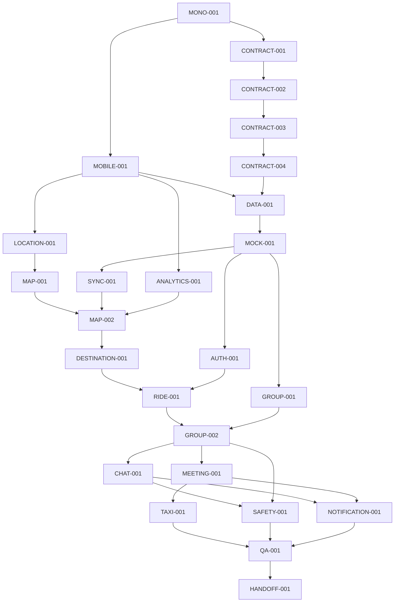

# Mobile MVP roadmap

Last updated: 2026-11-08. **MONO-001, MOBILE-001, TOOLCHAIN-001, CONTRACT-001, CONTRACT-002, CONTRACT-003 and CONTRACT-004 are completed; UI-001 is paused for an Android text fix (UI-001-D completed with its screen-reader checks waived until final device testing); DATA-001 is completed; MOCK-001 is completed (A, B, and C's demo controls); AUTH-001 is completed (A's mock operations, B's session controller with its native check in VERIFY-003, C's sign-in screens and pending-intent gate, D's settings and sign-out); SYNC-001 is completed (A's event synchronization, B's lifecycle integration); LOCATION-001 is completed (A's native checks in VERIFY-002, B's home recovery and named pickup); ANALYTICS-001 is completed; RIDE-001 is paused with A's mock request operations completed and B's draft and review, C's request card, cancel and expiry, and D's matches and unknown-outcome recovery implemented, their native checks pending; DESTINATION-001 is paused with A's supplied matches completed and B's destination search, selection and map emphasis implemented, its native check pending; MAP-001 is paused with A completed and B's map-centre picker implemented, its native check pending; MAP-002 is paused with A's discovery read and states, B's markers, clusters, list and tile notice, and C's ride and group previews and disappeared target implemented, their native checks pending; GROUP-001 is completed (A's joins, B's leave and coordinator transfer, C's status changes, expiry and terminal access); GROUP-002 is paused with A's join confirmation and conflict recovery, B's group screen and C's lifecycle controls and closed and revoked states implemented, their native checks pending; MEETING-001 is paused with A's mock meeting points completed and B's meeting point sheet and readiness integration implemented, its native check pending; CHAT-001 is paused with A's mock history and sending completed and B's chat screen and C's retry, catch-up, closure and revocation implemented, their native checks pending; SAFETY-001 is paused with A's mock reports, blocks, unblocks and block list completed and B's report form, receipt and failure recovery implemented, its native check pending; TAXI-001 is paused with A's Yandex Go link, taxi boundary and review completed and B's taxi review sheet, failure and scenario L implemented, its native check pending; all other implementation tasks are planned.**

## Milestone order

1. Implement a complete mobile MVP using realistic mocks.
2. Review and stabilize contracts against the working mobile product.
3. Future milestone: implement the backend against those contracts.
4. Future milestone: replace mock transport with HTTP/Socket.IO.

This roadmap covers only items 1–2. No backend implementation or real transport tasks are in the DAG. Completing a task does not authorize starting the next milestone automatically.

## Progress

**SAFETY-001-B — Implemented (2026-11-08), native check pending; SAFETY-001 `Paused` (A completed).**

- **Done:**
  - "Report …" in a member's menu, from the group screen (group context) and the chat (message context), opens the report form (41): four reasons, optional details with the privacy hint.
  - The receipt (42) shows only after the source accepts, saying it confirms mock acceptance only; `user_reported` records the reason alone.
  - A lost answer or busy service (52) keeps the reason and draft; "Retry report" reuses the operation ID, so an accepted report is never filed twice. A refusal stays on the form with its reason.
  - 594 mobile tests (6 new; member-menu checks updated).
- **Decisions:** edited content after an unknown outcome is a new report with a new ID; the sheet can't be dismissed while sending; 42's "Block this rider too" and the menu's block wait for SAFETY-001-C.
- **Pending:** the native check (DEVELOPMENT, report check).
- **Next available:** SAFETY-001-C (needs SAFETY-001-B), NOTIFICATION-001-A — behind paused native checks — or the native pass (sixteen cards).

**SAFETY-001-A — Completed (2026-11-08); SAFETY-001 `In progress`.** Started at the user's request while GROUP-002's and CHAT-001's native checks are pending.

- **Done:**
  - Mock blocks: block-and-leave in one step (the others see an ordinary leave; the blocker gets `access.revoked`), retries with their original result, no self-block, unknown riders refused; unblock restores nothing; the block list newest first with paging.
  - Pairing filtered both ways: discovery, nearby updates (removals reach only the pair), matches and joins (`BLOCKED_RELATIONSHIP` for the blocker, `TARGET_UNAVAILABLE` for the blocked).
  - Mock reports: receipt only after acceptance, retry returns the same receipt even after leaving, context access and target/message checks; no event, no block.
  - Scenario J (`safety`).
  - 588 mobile tests (14 new; scenario lists and unavailable-operation examples updated).
- **Decisions:** unblock raises no event (the app rereads discovery); blocks hide no chat messages, because the blocker leaves the shared live group and closed groups are unaffected.
- **Pending:** nothing for A. SAFETY-001-B (report form and outcomes) and C (block confirmation and blocked-riders list).
- **Next available:** SAFETY-001-B (needs SAFETY-001-A, UI-001-C, UI-001-D), NOTIFICATION-001-A — behind paused native checks — or the native pass (fifteen cards).

**TAXI-001-B — Implemented (2026-11-08), native check pending; TAXI-001 `Paused` (A completed).**

- **Done:**
  - Ready groups offer the taxi review to every member ("Review taxi details"; "Review Yandex Go handoff" for the coordinator). The group is read again first; the sheet (17) shows the pickup and destination the link carries and what opening means.
  - "Open Yandex Go" hands the reviewed trip to the OS; a changed point, destination or status makes the open review ask to be redone. A refusal (38) keeps the group ready and offers a retry, the website link and the trip details to copy or share.
  - `taxi_open_clicked` per attempt, `taxi_opened` on OS acceptance; nothing about the trip in analytics or logs. Returning to the app rereads the group; the handoff never changes it.
  - Mock scenario L (`taxi-unavailable`): the demo rider coordinates a ready group.
  - 574 mobile tests (4 new; scenario lists updated).
- **Decisions:** copying uses React Native's `Share` (its sheet offers Copy) instead of adding a clipboard module; scenario L scripts no taxi outcome, which stays the device's.
- **Pending:** the native check on both platforms (DEVELOPMENT, taxi check): Yandex Go absent, installed, and refused if reproducible.
- **Next available:** SAFETY-001-A (needs GROUP-002 and CHAT-001), NOTIFICATION-001-A (needs CHAT-001 and MEETING-001) — behind paused native checks — or the native pass, which would now cover fifteen cards.

**TAXI-001-A — Completed (2026-11-08); TAXI-001 `In progress`.** Started at the user's request while MEETING-001-B's native check is pending.

- **Done:**
  - The Yandex Go link in the documented format (`3.redirect.appmetrica.yandex.com/route`, pickup and destination, store or website fallback), checked against Yandex's deep-link page.
  - One taxi boundary, `openTaxi`/`openTaxiWebsite`: asks the OS once and reports `handed-off`, `failed` or `invalid`; never logs the link or places and touches no group.
  - The taxi review: only a ready group, its meeting point to its destination, refused for invalid or same places; it stops being current when the point (by ID or place), destination or status changes.
  - 570 mobile tests (12 new in `tests/taxi.test.ts`).
- **Decisions:** no fare (`tariffClass`) or partner ID (`ref`); `lang=en`. The review lives in `features/groups`, the link and opening in `platform/taxi`. Analytics, scenario L and copyable trip details are TAXI-001-B's.
- **Pending:** nothing for A. TAXI-001-B (sheet, fallback, refresh on return, both-platform installed/absent checks).
- **Next available:** TAXI-001-B (needs TAXI-001-A), SAFETY-001-A, NOTIFICATION-001-A — behind paused native checks — or the native pass, which covers fourteen cards.

**CHAT-001-C — Implemented (2026-11-08), native check pending; CHAT-001 `Paused` (A completed; B and C implemented).** Started at the user's request while CHAT-001-B's native check is pending.

- **Done:**
  - A message the source couldn't confirm stays as "You · not sent" (45); only "Retry message" sends it again, under the same client message ID; reconnecting sends nothing, and the chat says when the connection is interrupted.
  - Events join the history by message ID and sequence, so echoes and duplicates show once; a gap rereads the history. "Check latest messages" catches up over as many pages as needed.
  - A closed group's chat is read-only with the reason and the hour's limit (36); at its end, or on any denial, the history and typed text are cleared (37).
  - Mock scenario H (`failed-message`): a lost answer, a retry, a duplicate event, one message.
  - 558 mobile tests (4 new, failure cases rewritten).
- **Decisions:** reconnect relies on the coordinator's reread of the group's reads; explicit catch-up is the user's "Check latest messages". Retention is checked on the device clock as well as by the source.
- **Pending:** the native check (DEVELOPMENT, chat check and its CHAT-001-C additions).
- **Next available:** TAXI-001-A (needs MEETING-001), SAFETY-001-A (needs GROUP-002 and CHAT-001), NOTIFICATION-001-A (needs CHAT-001 and MEETING-001) — all behind native checks — or the native pass, which would now cover fourteen cards.

**CHAT-001-B — Implemented (2026-11-08), native check pending; CHAT-001 `Paused`.**

- **Done:**
  - The chat route (14) opens on the latest messages with sender and time, loads earlier ones back to the start in a stable order, and follows new messages while the reader is at the end.
  - The composer stays above the keyboard; a message shows "Sending…" at once, then as stored. Demo riders' answers arrive through the group subscription.
  - A message the source couldn't confirm goes back in the composer with its client message ID, so resending cannot post it twice; if the history shows it was stored after all, the composer lets it go.
  - Another member's message opens their menu; a closed group keeps its history without a composer; denied links get the group route's unavailable state.
  - Analytics record only the send intent and its confirmation, never text. 554 mobile tests (10 new).
- **Not covered here:** the failed-message bubble, catch-up and merging events by message ID, the full closed (36) and revoked (37) chat views, scenario H (CHAT-001-C); restoring a draft across sign-in.
- **Pending:** the native keyboard check (DEVELOPMENT, chat check) on both platforms.
- **Next available:** CHAT-001-C (needs CHAT-001-B, paused for its native check, and SYNC-001), TAXI-001-A (needs MEETING-001), or the native pass, which would now cover thirteen cards.

**CHAT-001-A — Completed (2026-11-08); CHAT-001 `In progress`.** Started at the user's request while GROUP-002's native checks are pending.

- **Done:**
  - The mock source stores each group's chat: the source sets the sender, time and gap-free sequence; text is checked against the contract's bounds.
  - Sending is idempotent per sender, group and client message ID: a retry or a lost answer gives one message, even after the group closed; a new message to a closed group gets `GROUP_CLOSED`. Members are told (`chat.message.created`).
  - History reads the latest page, older pages by cursor and catch-up pages after a sequence, for members and, after closure, for an hour; a member who leaves loses access at once.
  - Demo riders answer 4 seconds after the last message; scenario A's TSUM group starts with three messages.
  - 544 mobile tests (15 new).
- **Decisions:** history checks access before the cursor; scenario H belongs with the retry UI (CHAT-001-C).
- **Not covered here:** the chat screen and composer (CHAT-001-B); retry, catch-up merging, closure and revocation in the app (CHAT-001-C).
- **Next available:** CHAT-001-B (needs CHAT-001-A and UI-001-D, both done), TAXI-001-A (needs MEETING-001, paused for its native check), or the native pass, which would cover twelve cards.

**MEETING-001-B — Implemented (2026-11-08), native check pending; MEETING-001 `Paused`.** Started at the user's request while MAP-001's native check is pending.

- **Done:**
  - The group screen names the meeting point with the viewer's supplied walking time; without one it says a point is coming, offers "Refresh group" and keeps "Mark group ready" disabled with the reason (33).
  - "View meeting point" opens the members-only sheet (15): a small flat map with the landmark marker, the place, "About N min on foot" as an approximate demo estimate, and that it is a marker, not a route. Returning only closes it.
  - A suggested, replaced or withdrawn point is announced; the open sheet shows a replacement, and a ready group says it is forming again.
  - 529 mobile tests (5 new).
- **Decisions:** the taxi review does not exist yet; its rule (review the point by ID and start over when it changes) is recorded for TAXI-001.
- **Pending:** the native check (DEVELOPMENT, meeting point check), including the map inside the sheet on both platforms.
- **Next available:** CHAT-001-A or TAXI-001-A (needs MEETING-001), or the native pass, which would now cover twelve cards.

**MEETING-001-A — Completed (2026-11-08); MEETING-001 `In progress`.** Started at the user's request while GROUP-002's native checks are pending.

- **Done:**
  - The mock source suggests a meeting point 10 seconds after a group forms (and for scenario A's seeded forming group): the curated place nearest the group's public area that is not its destination, at its main entrance.
  - It can replace the point (new ID) or withdraw it; each change reaches members only (`meeting_point_changed`) and returns a ready group to forming. Without a point, a group cannot be marked ready. Closed groups never change.
  - Each member's group read carries their own walking estimate, supplied by the source from their own pickup (straight line, 80 m per minute), without revealing it or changing the version.
  - 524 mobile tests (6 new).
- **Decisions:** update policy documented in api/groups.md and MOCK_SCENARIOS; no scenario triggers replacement or withdrawal yet.
- **Not covered here:** the meeting point sheet and map landmark (MEETING-001-B).
- **Next available:** MEETING-001-B (needs MAP-001, paused for its native check), CHAT-001-A, or the native pass.

**GROUP-002-C — Implemented (2026-11-08), native check pending; GROUP-002 `Paused` (A, B, C implemented, native checks pending).**

- **Done:**
  - Coordinator controls by status: "Mark group ready" (disabled with a reason until there is a meeting point), "Reopen group for joining", "Mark group complete", "Cancel group" with a confirmation for everyone (49, 51). Members see "All set to meet." when ready (16).
  - Leaving asks first (34), cancels the request, removes the group's private data at once and returns to the map. When someone leaves, the screen says so and whether the viewer became coordinator (35).
  - Closed groups (18) give the reason, closing time and the read-only hour, with only "Back to the map". A denial from the source clears the group and shows that access ended (37).
  - Every change sends the version on screen and a fixed operation ID; a conflict rereads the group, an unknown outcome retries the same operation.
  - 518 mobile tests (9 new).
- **Not covered here:** meeting points from the source (MEETING-001-A) and their sheet (MEETING-001-B); taxi review (TAXI-001); the read-only chat link (CHAT-001); scenario D for trying the coordinator's controls by hand.
- **Pending:** the native checks (DEVELOPMENT, join, group and group lifecycle checks).
- **Next available:** CHAT-001-A or MEETING-001-A (both need GROUP-002, implemented but paused for native checks), or the native pass, which would now cover eleven cards.

**GROUP-002-B — Implemented (2026-11-08), native check pending; GROUP-002 `In progress`.**

- **Done:**
  - The group route shows the member-only group (13, 32): status and occupancy, departure and closing time, members with roles and "You", open seats, the meeting point or its absence, and the next step by role. Occupancy updates live 2 → 3 → 4 through a `group` subscription; a full group stays forming ("Full does not automatically mean ready.").
  - Each other member has a menu titled with that member (report and block shown disabled until SAFETY-001); the viewer has none.
  - Direct entry is decided by the source: signed out, a non-member, an unknown group or a malformed link all get "Group unavailable", with nothing from the link shown.
  - Joining opens the group; a grouped request's card offers "Open my group".
  - Found and fixed in the sync layer: the public tombstone of the rider's own ride or group made the private change of the same version look already known, so a ride joined by someone else (and an expired request) left the card unchanged; and a change between a private read and its subscription's acknowledgement was lost.
  - 509 mobile tests (6 new).
- **Not covered here:** ready, leave, reopen, complete, cancel and the revoked state (GROUP-002-C); the meeting point's sheet (MEETING-001-B); live occupancy on a device needs another rider (scenario D).
- **Pending:** the native check (DEVELOPMENT, group check).
- **Next available:** GROUP-002-C (group lifecycle screens), or the native pass.

**GROUP-002-A — Implemented (2026-11-08), native check pending; GROUP-002 `In progress`.** Started at the user's request while RIDE-001's native checks are pending.

- **Done:**
  - From a ride or group preview, a rider with an active request reaches "Confirm joining" (12) in the same sheet; it reads the plan again before "Join" can be pressed, and nothing changes until the source answers. Success: the card says "In a group".
  - A rider without a live request gets a draft to the plan's destination; publishing it opens the confirmation. A refused join then leaves that request active. An anonymous rider signs in first and continues by themselves.
  - Conflicts reconcile with the source: last seat taken or group ready (29, latest occupancy, request still active), plan gone (55), request ended or already grouped, blocked, session ended. A lost answer (30) is checked through the own request, or retried with the same operation ID.
  - 503 mobile tests (9 new).
- **Decisions:** the confirmation is a step of the preview, not a modal, so it never opens while the draft sheet closes; joined riders stay on home until the group route exists (GROUP-002-B).
- **Not covered here:** group screens and live occupancy (GROUP-002-B); `group` subscriptions.
- **Pending:** the native check (DEVELOPMENT, join check).
- **Next available:** GROUP-002-B (group route, members and seats), or the native pass.

**GROUP-001-C — Completed (2026-11-08); GROUP-001 `Completed`.**

- **Done:**
  - The coordinator changes the group's status (`groups.updateStatus`): ready (only with a meeting point; joins stop), reopen (joins resume), complete (from ready) and cancel (from either live status). Checks follow the contract's order: membership, coordinator role, closure, version, then the transition.
  - Completing or cancelling closes the group now: the members' requests complete or cancel with it, discovery removes it, and the members at closure can read it for one hour, then `HISTORY_EXPIRED`. Expiry uses the same closing step, dated at the deadline even after background time.
  - A closed group is read-only. The source has no taxi operation, so a taxi link can never change a group.
  - 494 mobile tests (7 new).
- **Not covered here:** supplying meeting points (MEETING-001-A); `group` subscriptions and the group screens (GROUP-002).
- **Next available:** GROUP-002-A (join confirmation and conflict recovery; needs GROUP-001 and RIDE-001, and RIDE-001 is still `Paused` for its native checks), so the native pass comes first unless the user decides otherwise.

**GROUP-001-B — Completed (2026-11-08); GROUP-001 `In progress`.**

- **Done:**
  - The mock source lets a member leave a live group (`groups.leave`) and serves the member-only group read (`groups.getGroup`), so a leave ends access at once: the leaver's next read answers `MEMBERSHIP_REQUIRED`.
  - The leaver's request is cancelled and never restored; they may publish a new one. A repeated leave with the same operation ID returns the original result; a new one answers `MEMBERSHIP_REQUIRED`; a closed group answers `GROUP_CLOSED`.
  - Two or more remain: a ready group returns to forming with its meeting point, and the earliest remaining member takes over if the coordinator left. One remains: the group is cancelled (`members_left`), that member's request is cancelled too, and they can read the group for an hour, then `HISTORY_EXPIRED`.
  - 487 mobile tests (7 new).
- **Decisions:** the member-only read landed here rather than in GROUP-001-C, because revocation is only observable through it.
- **Not covered here:** ready, reopen, complete and cancel (GROUP-001-C); leaving by blocking (SAFETY-001); `group` subscriptions; the group screens (GROUP-002).
- **Next available:** GROUP-001-C (status changes and terminal access), or the native pass.

**GROUP-001-A — Completed (2026-11-08); GROUP-001 `In progress`.**

- **Done:**
  - The mock source joins a rider's active request to a solo ride or a group (`groups.join`), with the contract's checks in order and the simulator's receipts: a retry returns the original result, a lost acknowledgement is recovered by the same operation ID.
  - Joining a solo ride forms a group of two, coordinated by that ride's rider, with its destination, departure and public area, and a 30-minute deadline that then governs both requests. A ride that is already grouped resolves to its group.
  - Two simultaneous first joins of one ride end in one group; two simultaneous last-seat joins end in one success and one `GROUP_FULL`; a fifth member is never seated; a refused join leaves the request active.
  - Discovery replaces the grouped rides with the group and never says why a ride left; owners get `ride.changed` and members `group.changed`.
  - 480 mobile tests (15 new).
- **Decisions:** an unknown own request answers `FORBIDDEN`, like another rider's; blocks are not checked until SAFETY-001 adds block records.
- **Not covered here:** leaving (GROUP-001-B); status changes, terminal access and the member-only read (GROUP-001-C); `group` subscriptions; the join screens (GROUP-002-A).
- **Next available:** GROUP-001-B (leave and coordinator transfer), or the native pass, which would complete MAP-001, MAP-002, DESTINATION-001 and RIDE-001.

**RIDE-001-D — Implemented (2026-11-07), native check pending; RIDE-001 `Paused`.**

- **Done:**
  - Mock scenario C (`match-appears`): unrelated activity; five seconds after the rider's request, the source supplies one excellent match with Aida's ride, holding three minutes. `rides.getMatches` serves the owner's set; `matches.changed` announces arrival and removal.
  - The card (11) says "Someone’s going your way.", names the plan when it is on the map, and offers "Review and join" (the preview, with "Excellent match") and "Keep looking". While a request searches, its matches emphasize the map, list and preview. A match leaves at its `expiresAt`, even before the source says so. `match_found` once per match per set version.
  - Unknown outcome (30): when publishing gets no answer, the review says the request may exist. "Check current request" reads it and finishes if it holds this plan, or says nothing was created; "Retry this request" resends the same operation, so the source returns the one request. A lost acknowledgement never creates two.
  - 465 mobile tests (8 new).
- **Decisions:** own matches take over emphasis from destination previews while a request searches; "Keep looking" only hides the card's block for that match and level; the signed-in join note in previews now says joining is not in this build yet (GROUP-002-A).
- **Not covered here:** joining (GROUP-001, GROUP-002-A); notifications for matches (NOTIFICATION).
- **Pending:** the native check (DEVELOPMENT, match check).
- **Next available:** GROUP-001-A (mock joins), or the native pass, which would complete MAP-001, MAP-002, DESTINATION-001 and RIDE-001.

**RIDE-001-C — Implemented (2026-11-07), native check pending; RIDE-001 `In progress`.**

- **Done:**
  - Home's card for the rider's request (10): destination, "You · leaving in 5 min", a countdown of the search window and "Cancel request"; a "You" marker at the published pickup. The countdown is presentation only: when the device sees the deadline pass, the card drops its action, says it is checking, and reads the request again; the source's status decides.
  - Cancel (28): a confirmation; the cancel sends the request's version and an operation ID fixed at the first press, retries only an unknown outcome, closes if the window ends meanwhile, and the card follows the source's answer. Nothing restarts by itself; "Create my ride request" returns.
  - Expiry (27), in the foreground or after time in the background: "Your request expired.", "Review a new request" (a new draft to the same place, published only when confirmed) and "Keep browsing". `ride_request_expired` once per request.
  - The own request stays current through a `user` subscription (`ride.changed`) and foreground reads.
  - Found and fixed: access tokens last 15 minutes, like the search window, and no feature renewed them, so a rider's own reads failed when the window ended. The composition root now runs every signed-in operation through the session's `runAuthenticated`.
  - 457 mobile tests (7 new).
- **Not covered here:** matches and "View current results" (RIDE-001-D); group screens for a grouped request (GROUP-002).
- **Pending:** the native check (DEVELOPMENT, request card check).
- **Next available:** RIDE-001-D (match scenario C, unknown-create recovery) or GROUP-001-A, or the native pass.

**RIDE-001-B — Implemented (2026-11-07), native check pending; RIDE-001 `In progress`.**

- **Done:**
  - With a destination, "Create my ride request" opens the draft (06): destination, pickup and Now / In 5 min / In 10 min, with the 15-minute window and the fixed-pickup note. The pickup is the one the rider confirmed, otherwise a fresh, accurate device fix; without either the sheet asks for one (on the map, or by name inside the same sheet).
  - An anonymous rider continues to sign in; the draft stays on home, and after sign-in the review (09) opens with the same plan. Leaving sign-in returns to browsing with the draft intact. Nothing is published by signing in.
  - "Publish my request" creates it once: the input and operation ID are fixed at the first press, presses while it runs do nothing, and a retry after no answer resends the same ID. Refusals explain what to do (stale location, outside the area, session ended). A rider who already has a live request sees it instead of a second create, and the create entry is hidden while one is live.
  - After publishing, home says the request is published, where it heads, when it leaves and until when others can find it (minimal; RIDE-001-C adds the card).
  - Analytics: `ride_request_create_clicked` and `ride_request_created`.
  - 450 mobile tests (6 new).
- **Decisions:** one sheet with steps, so no modal opens as another closes; the sheet closes before sign-in opens; operation IDs from `crypto.randomUUID` when present, otherwise a `Math.random` v4 UUID (an idempotency key, not a secret; no new dependency); the device fix's time is sent as taken (clock-offset correction waits for the HTTP adapter).
- **Not covered here:** the request card, countdown, cancel and expiry (RIDE-001-C); the own marker; matches and unknown-outcome recovery by reading the own request (RIDE-001-D). The unknown-outcome retry is unit-tested, not driven through the app.
- **Pending:** the native check (DEVELOPMENT, request draft check).
- **Next available:** RIDE-001-C (active card, countdown, cancel, expiry), or the native pass.

**RIDE-001-A — Completed (2026-11-07); RIDE-001 `In progress`.**

- **Done:**
  - The mock source creates, reads and cancels the signed-in rider's own request, with the contract's checks in order: validation, sign-in, the operation receipt (a retry returns the original, a changed input conflicts), stale device fix, outside the demo city, one live request; cancel's state errors before the version check.
  - A new request is active for 15 minutes from creation, departs now, +5 or +10 by the source's clock, and shows in discovery with a district-sized public area (a 0.01° grid cell) instead of its exact origin, which only the owner's own view contains. Expiry uses the existing deadline.
  - Discovery and nearby subscriptions leave out the viewer's own request and groups. `user` subscriptions now work for a signed-in rider (`ride.changed`).
  - 444 mobile tests (12 new).
- **Not covered here:** the draft, departure and confirmation screens (RIDE-001-B); the active card, countdown, cancel and expiry UI (RIDE-001-C); matches for the own request (RIDE-001-D). Started at the user's request while DESTINATION-001-B's native check is pending.
- **Next available:** RIDE-001-B (draft, departure, final confirmation), or the native pass.

**DESTINATION-001-B — Implemented (2026-11-07), native check pending; DESTINATION-001 `Paused`.**

- **Done:**
  - Home's sheet starts with "Where are you heading?" and "Choose a destination" (02). The destination sheet (03) searches the curated places ("Where to?", debounced, each search its own read, so older results never replace newer ones) and says it uses no live places service. Choosing a row sets the destination and records `destination_selected`; nothing is created or reserved, and the camera stays where it was.
  - With a destination (04), discovery reads its supplied matches. The sheet names the destination, the best level ("Excellent match nearby", "2 plans share your direction.") and "Inspect highlighted ride" (its preview, with the camera on it); while the read is on its way it says it is looking, and with no match it says other plans stay on the map. "Change destination" and "Clear destination"; clearing returns to general browsing.
  - Markers: matched plans outlined with their level in the accessible name, excellent ones filled lime; unrelated plans stay, faded. Clusters say how many plans go the rider's way. The nearby list and the preview show the level too.
  - An earlier destination's snapshot never answers for a newer one: emphasis appears only for a snapshot read for the current destination.
  - 432 mobile tests (7 new).
- **Decisions:** the destination is local to the home screen (presentation state) until RIDE-001 needs it for a request; no arrival animation on native markers (they are bitmaps on Android); the place list is shared with the pickup sheet.
- **Not covered here:** "Create my ride request" (RIDE-001); departure choice in discovery (RIDE-001's departure draft).
- **Pending:** the native check (DEVELOPMENT, destination check).
- **Next available:** RIDE-001-A (mock request operations; needs DESTINATION-001 and AUTH-001), or the native pass.

**DESTINATION-001-A — Completed (2026-11-07).**

- **Done:**
  - The mock source supplies destination matches as fixtures: a nearby read that names a destination (and optionally a departure choice) returns the scenario's matches for it as `previews`, only for the returned items and in their order; the items stay the same, so unrelated activity remains. A match leaves with its item.
  - Scenario A has hand-written matches for nine destinations (one limited to departures +5/+10, one to "now"); the ready group has none. Scenario M has a match per block's first ride and per group.
  - Place search is reused unchanged: it is already deterministic, bounded and cancellable.
  - 425 mobile tests (6 new, replacing the empty-previews case).
- **Decision:** matches are seed data keyed by destination, never computed (no geocoder, routing or scoring).
- **Not covered here:** the destination sheet, selection and map emphasis (DESTINATION-001-B). Started at the user's request while MAP-002's native checks are pending.
- **Next available:** DESTINATION-001-B (it also needs UI-001-C, completed), or the native pass.

**MAP-002-C — Implemented (2026-11-07), native check pending; MAP-002 `Paused`.**

- **Done:**
  - A marker or a list row opens that ride's or group's public preview in home's sheet, with the marker highlighted and a header naming it ("Ride preview · Asia Mall · ~350 m"). The back button, "Back to map" and Android back close it.
  - Every open reads the target again (`GET /rides/{rideId}` or the group preview); until the source confirms it, the sheet shows the map's copy with "Checking it’s still available…" and no join action. A failed check shows "Try again" and no join.
  - Ride preview (05): destination, approximate distance, departure, the rider's display name and "One seat · Public demo profile", and the approximate-pin note. Group preview (19): status and free seats ("Forming · one seat open", "Room for one more."), occupancy, departure, and that members, chat and the meeting point stay private; only a forming group with a free seat offers "Create a request to join".
  - Disappeared target (55): when the source answers `TARGET_UNAVAILABLE` (expired, cancelled, grouped, closed), including while the preview is open, the sheet says "That plan has changed.", that nothing was reserved and the rider's own request stays active, and offers "Refresh nearby plans".
  - The join action reserves nothing and sends nothing: it records the intent (through sign-in for an anonymous rider). After sign-in the preview reopens, reads the target again for the signed-in rider, and says joining starts from the rider's own request, which this build cannot create yet.
  - 420 mobile tests (7 new).
- **Decisions:** the preview replaces the sheet's content rather than opening a modal sheet, so the map and highlighted marker stay visible and sign-in can open over it; the source's answer, not the snapshot, decides `gone`; `group_join_clicked` belongs to the join confirmation (GROUP-002-A).
- **Not covered here:** match emphasis ("Excellent match", DESTINATION-001-B); creating a request (RIDE-001) and the join confirmation (GROUP-002-A).
- **Pending:** the native check (DEVELOPMENT, previews check).
- **Next available:** the native pass for MAP-001-B and MAP-002 (A, B, C), which would complete MAP-001 and MAP-002; DESTINATION-001-A depends on MAP-002.

**MAP-002-B — Implemented (2026-11-07), native check pending; MAP-002 `Paused`.**

- **Done:**
  - Markers for the snapshot the sheet describes, at each item's public area: a ride shows its destination (and approximate distance with a device position), a group its destination and occupancy. Where markers would overlap, a lime cluster counts ride plans; a group counts once. Clusters come from a power-of-two grid anchored to absolute coordinates, so they stay put while panning. A cluster tap zooms in when that can separate its items; items sharing one public area are listed instead. The last view is drawn faded.
  - "View nearby items" opens the list (20): the same items in the source's order, with the demo badge, notices when the source left items out or the list is the last view, and what the counts mean. A row selects its item and moves the camera there; a marker tap selects it in place. "Selected on the map" names it until cleared. Nothing is reserved or opened (previews are MAP-002-C).
  - Screen 26: when Google Maps has not reported its tiles, the sheet says the map can't load and points to the list.
  - Mock scenario M `map-density`: 100 items (75 rides, 25 groups of two) on a grid of synthetic demo blocks.
  - Analytics: `nearby_marker_seen` through marker visibility (single items only, after the 1 s dwell) and `nearby_marker_tapped`.
  - 413 mobile tests (12 new, including the density seed).
- **Decision:** no clustering dependency; a grid is enough for at most 100 items.
- **Not covered here:** ride and group preview sheets and disappeared selections (MAP-002-C); match emphasis (DESTINATION-001-B).
- **Pending:** the native check (DEVELOPMENT, markers and list check), with the 100-item scenario.
- **Next available:** MAP-002-C (previews).

**MAP-002-A — Implemented (2026-11-07), native check pending; MAP-002 `Paused`.**

- **Done:**
  - Discovery for the region the map last rested on: the region is rounded outward to a 0.01° viewport (views wider than 0.5° ask to zoom in), read through `rides.getNearby` with a nearby subscription for the same viewport. Each viewport is its own read, so a read for a view the user left is aborted and cannot replace the newer one; while a moved view loads, the previous snapshot stays shown as "Updating for this area…". Discovery never moves the camera.
  - The top of home's sheet says only what is known: loading (54, "not empty"), activity (02, a count of riders and groups that never claims completeness when truncated), empty (23), a failed read with nobody knowing whether anyone is nearby (24, "Retry discovery"; outside the demo area said as such), waiting for a connection, and the last view while offline or after a failed refresh (25, "last updated", nothing queued).
  - Analytics is created by the app for the first time: `map_opened` once per session; `nearby_activity_exposed` once per completed connected read, with the count bucket and truncation, and never for a placeholder, stale or failed snapshot.
  - 401 mobile tests (15 new).
- **Not covered here:** markers, clusters, the nearby list and the tile fallback (MAP-002-B); previews (MAP-002-C); "Create a ride request" on the empty state (RIDE-001); destinations (DESTINATION-001).
- **Pending:** the native check (DEVELOPMENT, discovery check) in the next native pass, with MAP-001-B's.
- **Next available:** MAP-002-B (markers, list, tile fallback).

**MAP-001-B — Implemented (2026-11-07), native check pending; MAP-001 stays `Paused`.**

- **Done:**
  - Map picker (screen 22) on home: "Choose pickup area" and "Change pickup point" show a fixed pin over the visible centre, with "Confirm pickup" and a back button in the header. The point under the pin is read from the map whenever the camera rests, so it matches the pin whatever the header and sheet cover. While the map moves, confirmation waits.
  - The sheet names the nearest curated place within 1 km ("Near Ala-Too Square (City square)"), says when none is close or the name could not be found, and keeps design 22's notes. Only the point rounded to 0.01° is sent to name it; the exact point stays on the device.
  - "Confirm this pickup" sets a `map-point` pickup (the exact point, `source: 'manual'`, named after the nearest place or "A point you chose on the map"); nothing is sent. "Choose a named place" opens the named list, the accessible alternative; a build without a map goes straight to it.
  - Tile status (`src/platform/map/useMapTileStatus.ts`) is a platform fact apart from the data source; the picker warns when Google Maps has not reported its tiles within 15 s. Screen 26 (MAP-002-B) builds on it.
  - 386 mobile tests (16 new; place-list tests now reach the list through "Choose a named place").
- **Not covered here:** screen 26's tile fallback and nearby list (MAP-002-B); narrowing searches to the visible map (the named list keeps the whole demo area); Apple Maps reports no tile state.
- **Pending:** the native check (DEVELOPMENT, map picker check) in the next native pass.
- **Next available:** MAP-002-A (discovery).

**MAP-001-A — Completed (2026-11-07): the Android stale-dot fix.**

- **Done:** `DevicePosition` (`src/features/map/HomeMap.tsx`) keeps a ref to its marker and calls `redraw()` a frame after the dot changes between fresh and out of date, because react-native-maps' Android marker draws its custom view as an image. On the Android emulator the dot measured `#586D68` (muted) once out of date and teal again after Refresh location. The map stand-in records redraws (`redrawMarker`); `tests/mapHome.test.tsx` checks one redraw when the position goes out of date. 370 mobile tests, typecheck and lint pass.
- **Not covered:** the iOS stale dot on the simulator (its precise-location switch could not be turned back on); iOS draws the marker view live and supports `redraw()`.
- **Next:** MAP-001-B (map-centre picker), which the user asked for.

**VERIFY-004 — Completed (2026-11-07): Android map check with the user's Google Maps key. MAP-001-A stays `Paused` for one defect.**

- **Done:** with `GOOGLE_MAPS_ANDROID_API_KEY` in `apps/mobile/.env.local`, `android/` regenerated and rebuilt; Google Maps draws Bishkek with the Google logo above the sheet, the dot and first camera move, a pan stops following, Show my location recenters at street scale (flat, north-up), a confirmed pickup draws its pin, and a denial shows the demo city with no dot or recenter button.
- **Defect found:** after two minutes without a new fix the card says "Your location is out of date", but the dot stays teal (`#146B59`, measured) instead of muted. react-native-maps' Android marker draws its custom view as an image and redraws it only on its own updates; giving the marker a `key` per state did not change it (reverted). Fixing it needs its own change (for example a separate marker image per state, or `tracksViewChanges` handling) and a device check.
- **Also seen:** the Android pickup pin is a light teal default pin, because Google Maps turns `pinColor` into a hue (ink is not reproducible); the iOS stale dot is still unchecked.
- **Next available:** the user deferred the stale-dot fix to the backlog (2026-11-07); MAP-001-B and MAP-002-A can start with the defect known.

**VERIFY-003 — Completed (2026-11-07): native pass for AUTH-001-B, AUTH-001-C, AUTH-001-D, MAP-001-A and LOCATION-001-B. AUTH-001-B and AUTH-001 are `Completed`; MAP-001-A stays `Paused`.**

- **Done:** both development clients rebuilt from clean native folders (iOS 26.5 simulator, Android 16 emulator) and checked: session (no SecureStore error, no Face ID text, Android backup rules), sign-in (keyboards, footer above the keyboard, iOS paste, swipe/back/Close, sign-in back to the map), settings and sign-out (sheet, Keep me signed in, back or busy dismissal refused, confirmed and unconfirmed outcomes, back to the map), the iOS map (render, Bishkek, recenter, a pan stops following, approximate area only, denial without a dot, pickup pin), Android's no-key notice, and the location introduction, cards and settings path.
- **Not covered:** Android map rendering (no key yet), a stale (grey) dot, Android paste (adb cannot set the emulator's clipboard without touching the Mac's), screen readers (waived).
- **Next available:** MAP-001-B and MAP-002-A still follow MAP-001-A, which needs the Android key check; the user decides whether to provide the key or to proceed with iOS evidence.

**AUTH-001-D — Completed (2026-11-07); AUTH-001 stays `Paused` (only B's native check is pending).**

- **Done:**
  - Settings (40) replaces the inert route and opens from home's new Settings button: signed-in (display name, a warning when the session could not be saved, Sign out), signed-out (anonymous browsing, Sign in returning to settings), restoring and failed-restore (Try again) variants; the location permission summary; the demo label on the mock source.
  - Sign-out confirmation (48) in a sheet (`SignOutSheet`): what is cleared, that anonymous browsing remains, and that signing out does not leave a group or cancel a request; it cannot be dismissed while running, and an unexpected failure can be retried.
  - Signing out uses the session controller; the sync coordinator clears private reads and subscriptions; the root stack is reset to map + settings so no private screen stays beneath. The outcome (`signOutOutcome.ts`) is shown honestly: only a confirmed revocation with storage cleared says private details were cleared.
  - 370 mobile tests (20 new; the inert settings case was replaced).
- **Not covered here:** notification permission (NOTIFICATION-001-B) and blocked riders (SAFETY-001-C) on settings; push-device deregistration on sign-out (NOTIFICATION-001).
- **Next available:** the native pass (MAP-001-A, LOCATION-001-B, AUTH-001-B, AUTH-001-C, AUTH-001-D), which would complete AUTH-001 and unblock MAP-001-B and MAP-002-A.

**AUTH-001-C — Completed (2026-11-07); AUTH-001 stays `Paused` (B's native check pending, D planned).**

- **Done:**
  - Sign-in screens replace the placeholders: phone (07), code (08), fresh code (47) and session ended (31), in `src/features/auth/`. On the mock source they start from a demo number, show the demo code and say that no SMS is sent; autofill of the device's number is off. Refusals (format, a non-demo number, a resend too soon with its wait, wrong code, expired or used challenge, too many wrong codes, no connection) show the app's own copy and never repeat the number or code.
  - The flow (`SignInFlow`, the auth layout) keeps the number and challenge in memory only, closes itself once a rider is signed in, and tells the gate when it closes without sign-in. A refused refresh opens the session-ended screen (`SessionExpiryRedirect`).
  - Typed pending-intent gate (`pendingIntent.ts`, `PendingIntentProvider.tsx`): `useRequireSignIn()` keeps a create/join/send intent (data only) and opens sign-in; `useResumeIntent(kind, onResume)` hands it back to its screen after sign-in, which reads the target again and shows its confirmation. Nothing is created, joined or sent by signing in. Cancelling drops the intent; drafts stay on their screens.
  - Home shows "Sign in" only while nobody is signed in. `DemoSignIn` (composition, `DemoSignInProvider`) tells the screens how to sign in to the mock.
  - 351 mobile tests (20 new; the 5 placeholder navigation tests were replaced).
- **Not covered here:** settings and the sign-out confirmation (AUTH-001-D); real protected actions and their confirmations (RIDE-001, GROUP-001, CHAT-001), which must use the gate.
- **Next available:** AUTH-001-D (settings and sign-out). MAP-001-B and MAP-002-A follow MAP-001-A's native checks.

**SYNC-001-B — Completed (2026-11-07); SYNC-001 is `Completed`.**

- **Done:**
  - `src/data/createSyncCoordinator.ts`: features `watch` logical subscriptions (shared when equal, `user`/`group` only when signed in, refusals reported and retried after the next reconnect or identity change); events from a subscription that has since ended are dropped. An identity change ends every subscription, cancels and removes the previous rider's reads (so a late result cannot restore them), resets the synchronizer and subscribes again for the new viewer. Reconnect subscribes again and rereads the viewer's data; Query's online state follows the connection and its focus follows `AppState`. A demo scenario start subscribes again into the new world.
  - `SyncProvider` and `useEventSubscription(request, onError?)`; `useViewer()` and `viewerOfSession` derive the query viewer from the session. The composition root now builds the Query client and the coordinator; the root layout starts it. Mutations never wait for the connection (no offline queue).
  - 331 mobile tests (10 new): late private reads after the session ends, dropped stale deliveries, resubscription per viewer, reconnect rereads, focus, five rounds of reset and reconnect leaving one live subscription.
- **Not covered here:** the stale/offline banner (MAP-002-A), the session-expired screen (AUTH-001-C), chat catch-up (CHAT-001-C). Nothing watches a subscription yet; discovery is the first (MAP-002-A).
- **Next available:** AUTH-001-C (its dependencies AUTH-001-B, SYNC-001-B, UI-001-C and UI-001-D have code; AUTH-001-B's native check is still pending). MAP-001-B and MAP-002-A follow MAP-001-A's native checks.

**SYNC-001-A — Completed (2026-11-07).**

- **Done:**
  - `src/data/synchronizeEvents.ts`: `createEventSynchronizer(queryClient)` applies realtime events to the Query cache once (by event ID) and only when newer than the version known for that resource, kept per viewer. Nearby upserts patch snapshots that hold the item and its preview read, and invalidate the rest; removals leave tombstones. Private events are dropped for another user or a revoked group, and otherwise invalidate older own-request, match, group and chat reads; `access.revoked` removes the group's private data unless a newer version shows a rejoin. An invalid event is reported by type only and rereads the viewer's data.
  - Snapshot/event races: every successful read is reconciled with what events taught (newer upserts replace older items, tombstones drop them, older single-resource reads are reread once), and an upsert during a first read in flight triggers one reread after it lands. `synchronizeSubscription` pipes a subscription into it.
  - 321 mobile tests (16 new), including mock-source races at the scenario's 8-second appearance and 20-second expiry.
- **Not covered here:** creating the synchronizer in the app, foreground/reconnect resubscription and rereads, and resets on identity or scenario change (SYNC-001-B); merging chat messages (CHAT-001-C). Nothing in the app subscribes yet (MAP-002-A).
- **Next available:** SYNC-001-B (needs A and AUTH-001-B, whose code exists; its native check is pending but SYNC-001-B is JavaScript only). MAP-001-B follows MAP-001-A's native checks.

**AUTH-001-B — Paused (2026-11-07): implemented; the native check of `expo-secure-store` is pending.**

- **Done:**
  - `expo-secure-store` 57.0.4 and `src/platform/secureStorage/credentialStore.ts`: the refresh token alone, under a per-data-source key (`ridematch.mock.refreshToken`, later `ridematch.api.refreshToken`), readable only while the device is unlocked and never restored to another device; the config plugin adds no Face ID text and keeps the key out of Android backups.
  - `src/features/auth/createSessionController.ts` with `AuthSessionProvider`, `useSessionController()` and `useSessionState()`: the access token stays in memory and reaches the data source through `getAccessToken`; callers that find it expired share one refresh (`runAuthenticated`); a refused refresh token ends the session as `expired`; sign-out revokes at the source, then signs out locally even offline or with a failing store and reports what was not confirmed; late results never restore a session, and storage calls run in order. Launch restore renews a stored session, except on the mock source, whose in-memory world cannot keep one, so the demo key is cleared instead.
  - The composition root builds the session with the data source and passes its token to every call; starting a demo scenario signs the app out. 305 mobile tests (21 new).
- **Not covered here:** the sign-in screens and protected-action gate (AUTH-001-C), settings and the sign-out confirmation (AUTH-001-D), identity-change clearing of cached private data and subscriptions (SYNC-001-B), push-device deregistration (NOTIFICATION-001). Nothing in the UI signs in yet.
- **Pending:** rebuild both development clients and check that the app launches with the new native module (see DEVELOPMENT's session check), in the same native pass as MAP-001-A.
- **Next available:** SYNC-001-A. SYNC-001-B needs SYNC-001-A and AUTH-001-B; MAP-001-B follows MAP-001-A's native checks.

**AUTH-001-A — Completed (2026-11-01).**

- **Done:**
  - `src/data/mock/auth.ts` behind the mock source's `auth` namespace: one-time code challenges for demo numbers only (Ofcom's fiction range, +44 7700 900000–900999), the demo code `123456`, a synthetic rider per number, sessions with rotating refresh tokens, idempotent logout and the current user. `AUTH_POLICY`'s resend interval, challenge lifetime, attempt limit and token lifetimes apply on the simulated clock.
  - An `AccessTokenSource` port lets an implementation send the session's access token; the app stays anonymous until AUTH-001-B's session controller supplies it. The simulator's errors can now carry field errors and a retry delay.
  - 284 mobile tests (16 new): every boundary of the policy, used and replaced challenges, rotated and revoked tokens, field errors that repeat no input, determinism and reset.
- **Not covered here:** the session controller, secure storage and the sign-in screens (AUTH-001-B to D). Nothing in the app calls these operations yet.
- **Next available:** AUTH-001-B (session controller and secure storage) and SYNC-001-A. MAP-001-B follows MAP-001-A's native checks.

**MOCK-001-C — Completed (2026-11-01); MOCK-001 is `Completed`.**

- **Done:**
  - The `DevControls` port (`src/data/DevControls.ts`, `useDevControls()`), created by the composition root with the mock source only in development and preview builds; production builds never create it.
  - `/dev/scenarios` (screen 50), opened from home's Demo badge: the 14 documented scenarios with only the two implemented ones selectable, restart, Online/Offline, moving the source's clock ahead, and a failure for the next request (no answer or refused). Starting a scenario resets the one simulator into it, so the data source stays the same, and clears the app's cached reads. Production builds show an unavailable state and no entry on home.
  - `ScreenHeader` and two more design icons. 268 mobile tests (12 new).
- **Parent check:** reset is repeatable and leaves no timers or listeners (A's tests, and a scenario switch leaves the same counts as a fresh simulator); public outputs contain no exact private locations (B).
- **Not run (JavaScript only, deferred):** opening the screen on a device. The next native pass needs rebuilt clients anyway (MAP-001-A).
- **Next available:** AUTH-001-A and SYNC-001-A (both need the whole MOCK-001). MAP-001-B follows MAP-001-A's native checks.

**MAP-001-A — Paused (2026-11-01): implemented, native checks pending.**

- **Done:**
  - `react-native-maps` 1.27.2 and `react-native-svg` 15.15.4, the versions Expo SDK 57 lists. Home is now a map (Apple Maps on iOS, Google Maps on Android) in `MapLayout`: a floating "along" title and Demo badge, "Show my location" above a fixed bottom sheet, and the location card, the confirmed pickup and the temporary Sign in moved into that sheet.
  - `src/features/map/`: the device position from the location controller (dot with accuracy circle, grey when stale, circle only under approximate permission, nothing with a denial), the confirmed pickup's pin, a camera that opens on the demo city and moves once to the first position or a newly confirmed pickup and never fights the user's own panning, and observation only while home is the focused screen.
  - The Android key comes from `GOOGLE_MAPS_ANDROID_API_KEY` (ignored `.env.local` or the shell) through Expo's `android.config.googleMaps.apiKey`, which stays out of the public configuration; without a key Android shows a notice instead of a map that would stop the app. 256 mobile tests (13 new); typecheck, lint, peers and doctor (21/21) pass.
- **Pending (deferred native pass):** rebuild both development clients (both libraries are native) and run DEVELOPMENT's map shell checks: rendering, pan and zoom, Bishkek coverage, recenter, denial browsing, logo and legal notice above the sheet. Android rendering also needs the user's restricted Google Maps key; without it, check the notice.
- **Next available:** MOCK-001-C. MAP-001-B (map-centre picker) follows MAP-001-A's native checks.

**LOCATION-001-B — Completed (2026-11-01); LOCATION-001 is `Completed`.**

- **Done:**
  - `src/features/location/`: the location introduction (screen 01), which shows the OS prompt only on "Use my location" and can be set aside for the launch; a home location card for every state that needs words (screen 21 and its siblings), with a second action that fits the cause (ask again, open the settings, location services first, retry a fix); and a named pickup point chosen from the curated places through `places.search` and confirmed explicitly, kept as a frozen `manual` location for the request draft.
  - The root layout creates, starts and disposes the one location controller and provides this launch's choices. `src/platform/location/openLocationSettings.ts` opens the settings. 243 mobile tests (22 new), through the real routes with a stand-in device.
- **Parent check:** allow, deny, unavailable, stale and recovery paths (A natively in VERIFY-002, B in tests); observation stops in the background (VERIFY-002); a confirmed pickup and a captured fix never move (frozen, tested).
- **Not run (JavaScript only, deferred):** opening the new screens on a device. The next native pass should look at the introduction, the cards and the settings links on both platforms.
- **Next available:** MAP-001-A (needs LOCATION-001 and UI-001-D) and MOCK-001-C.

**UI-001-D — Completed (2026-11-01, user waiver).**

- **Decision:** the user marked the TalkBack and VoiceOver checks as accepted without running them, and will test them in the final device testing, once everything including the backend works. They were not run: focus returning to the opener after a sheet closes, the VoiceOver escape gesture, and the announced confirmation error. Jest covers the calls; VERIFY-001 verified the rest natively.
- **Unblocked:** MOCK-001-C and LOCATION-001-B now have all their prerequisites; MAP-001-A follows LOCATION-001-B, and AUTH-001-A and SYNC-001-A follow MOCK-001-C.

**VERIFY-002 — Completed (2026-11-01): native pass for LOCATION-001-A; LOCATION-001-A is `Completed`.**

- **Done:**
  - Both development clients rebuilt from regenerated native folders (iOS: 106 pods, 0 errors; Android: BUILD SUCCESSFUL in 49 s). Both open on the home screen with the mock source composed from `.env`, which also closes DATA-001-A's deferred native check; both exports pass.
  - The LOCATION-001-A permission checks on the iPhone 17 Pro simulator (iOS 26.5) and the Pixel 9 Pro XL emulator (Android 16): no prompt until requested, the when-in-use text, no "always" option in the prompt, the settings or the manifest, denial, permission granted in the settings picked up on return, approximate location never accurate enough for a pickup, location services off, and observation stopped in the background and resumed on return (iOS `locationd` log, Android's location request list).
  - **Fix:** iOS reports every app's permission as denied while location services are off, so the controller showed a denial. A denial now also reads the services state, and `describeLocation` reports `services-off` before `denied`. One new test (221 mobile tests).
- **Finding for LOCATION-001-B:** on Android, expo-location still reported `canAskAgain: true` after the second denial; only a third request, which showed no dialog, returned `false`.
- **Not done:** UI-001-D's screen-reader checks. The user postponed them and chose not to sign an iPhone build for VoiceOver yet; later the same day the user waived them until final device testing (entry above).

**ANALYTICS-001-A — Completed (2026-11-01); ANALYTICS-001 is `Completed`.**

- **Done:**
  - `src/analytics/`: the event catalog from DEVELOPMENT.md with stages (`view`, `intent`, `success`, `observed`) and bounded properties, checked by types and by `validateEvent` (sensitive, unknown, missing and out-of-range properties rejected without echoing values); `createAnalytics` with sessions (new after 30 minutes away), once-per-session and once-per-key events, and marker dwell (1 second of foreground visibility, once per target per session); a context with environment, version, scenario, pseudonymous identities and `synthetic`; memory and no-op sinks; `isRealUserEvent`; the provider and hook. Not created by the app yet. 220 mobile tests (27 new).
- **Parent check:** intent and success events are distinct, sensitive properties are rejected, and mock events are excluded from real-user metrics (all tested).
- **Not run (no native change):** exports and native builds.

**LOCATION-001-A — Completed (2026-11-01; native checks in VERIFY-002).**

- **Done:**
  - `expo-location` 57.0.22 with a foreground-only config plugin entry (iOS when-in-use text only; Android coarse and fine location only).
  - `src/platform/location/`: the `LocationServices` port over Expo Location, `createLocationController` (permission without prompting until asked, cached then fresh fixes with a 15-second timeout, services checks, observation only while needed and in the foreground, recheck on return, permission loss clears the fix), `describeLocation` and `assessFix` (fresh, recent or stale; accurate; usable for a pickup), and `LocationProvider` with its hooks. Not mounted yet. 193 mobile tests (25 new).
- **Native checks:** passed on both platforms in VERIFY-002 (above), with the services-off fix.

**MOCK-001-B — Completed (2026-11-01).**

- **Done:**
  - `src/data/mock/`: world records with exact origins and meeting points kept private (`world.ts`); safe serializers for users, places, public rides, group previews, nearby items and events (`serializers.ts`); 12 curated places and the demo coverage (`places.ts`); the `active-neighborhood` and `empty-neighborhood` seeds with deadlines and scenario A's timed events (`scenarios.ts`, `lifecycle.ts`); place search, nearby discovery, ride and group previews and nearby subscriptions (`discovery.ts`); `createMockSimulator` and the `AppDataSource` adapter (`createMockDataSource.ts`), where every other operation is unavailable.
  - Composition: the root layout runs the configured scenario from launch and disposes it on unmount; an unknown scenario key shows the configuration error screen. 168 mobile tests (33 new).
- **Parent check (partial):** public outputs contain no exact private locations (every output and every event of a full scenario run checked), and reset stays repeatable with the seeds. The dev controls (C) remain.
- **Not run (deferred; no native configuration changed):** a development build or export. The app still shows the map placeholder, since no feature reads yet.

**MOCK-001-A — Completed (2026-11-01).**

- **Done:**
  - `src/data/mock/`: the simulated clock (real time plus an advanced offset), seeded randomness, deterministic IDs, the scheduler that catches up overdue tasks after background time, a typed emitter, idempotency receipts, and `createSimulator`: seeded latency, the operation pipeline (due tasks first, synchronous work, events only after it completes), explicit `network` (before or after commit) and `source` failures, connection loss that ends subscriptions, aborts, reset and disposal.
  - `MOCK_SCENARIOS.md`: the implemented rules. 135 mobile tests (30 new).
- **Parent check (partial):** reset is repeatable and timers and listeners do not accumulate (tested over ten resets and disposal). Safe public outputs and minimal seeds (B) and the dev controls (C) remain.
- **Not run (no app code path uses it yet):** native builds and exports.

**DATA-001-B — Completed (2026-11-01); DATA-001 is `Completed`.**

- **Done:**
  - `@tanstack/react-query` 5.104.5 with one client per launch in the root layout: reads retry at most twice and only when a retry may succeed; mutations never retry automatically.
  - `src/data/errors.ts`: the mobile error model (`DataError` with `source`, `network`, `unavailable`, `aborted` and `unexpected` kinds; source bodies validated against `ApiErrorSchema`), normalization, and Query's error type.
  - `src/data/queryKeys.ts` and `queries.ts`: keys scoped by viewer identity with every parameter, a public scope for place search, a per-group prefix for private data, and read options that pass Query's abort signal.
  - ESLint blocks simulator imports outside the composition root and the simulator. The contracts smoke import is removed. 105 mobile tests (36 new).
- **Parent check:** features cannot import the simulator (lint, tested with controlled imports), unsupported API mode fails clearly (A), and identity and parameters are in the query keys (tested).
- **Not run (deferred):** a development build or export, as for A. No native configuration changed.

**DATA-001-A — Completed (2026-11-01).**

- **Done:**
  - `src/config/appConfig.ts`: validates `EXPO_PUBLIC_APP_ENV`, `EXPO_PUBLIC_DATA_SOURCE` (`mock` or `api`) and, for `mock`, `EXPO_PUBLIC_MOCK_SCENARIO`, with no defaults and every problem named. `apps/mobile/.env` holds the development values.
  - `src/data/`: the `AppDataSource` interface with its eight typed namespaces (one operation per documented endpoint, signals on reads only, typed event subscriptions and connection state), `createDataSource` (the one branch on the kind: `api` fails with `DataSourceUnavailableError`, never falling back to the simulator), `DataSourceProvider`/`useDataSource()`, and an unavailable stand-in for the mock slot until MOCK-001.
  - `src/bootstrap/`: one composition per launch; the root layout provides the data source or shows a "This build can’t start" screen. 69 mobile tests (27 new).
- **Parent check (partial):** unsupported API mode fails clearly. Query keys with identity and parameters, the error model, read cancellation and the import restriction (B) remain.
- **Not run (deferred to the later verification pass):** a development build or export confirming the app reads `apps/mobile/.env` and opens on the map. No native configuration changed.

**CONTRACT-004-B — Completed (2026-11-01); CONTRACT-004 is `Completed`.**

- **Done:**
  - `notifications.ts`: the four notification payloads (`matches.available` with the own request and one target or `null`, `group.member_joined`, `group.ready`, `chat.message_created` with the group and message), each with a notification ID, schema version 1, `issuedAt` and `expiresAt` (at most one hour later), and their union on `kind`. Push-device registration: installation UUID, Expo push token, platform, permission state, and a receipt with the installation and registration time only.
  - `api/realtime.md`: recipients per kind, fixed generic copy (no display text in payloads), tap handling for invalid and expired payloads, and the registration rules (upsert without an operation ID, takeover by another user, a token never reaching two users, removal before sign-out). No error codes were added. 860 contract tests (79 new).
- **Parent check:** each event has a validated payload, audience and cache/recovery rule (A), and the notification payloads contain no sensitive content: text, names, coordinates, phone numbers, tokens and links all fail (B).
- **Not run (no app code changed):** mobile Jest, exports and native builds.

**CONTRACT-004-A — Completed (2026-11-01).**

- **Done:**
  - `realtime.ts`: the event envelope (event ID, schema version 1, occurrence time, type, audience, payload), the three audiences (public, one user, one group's members), the seven events with their payloads and cache rules, the per-subscription event unions, and the subscription request (`nearby` viewport, `user`, `group`), acknowledgement and unsubscribe.
  - `api/realtime.md`: payload and cache action per event, removal, group-change and revocation reasons that never reveal a join or a block, subscription errors, and the events one block-and-leave raises. No error codes were added. 781 contract tests (82 new).
- **Parent check (partial):** each event has a validated payload, audience and cache/recovery rule. Notification payloads (B) remain.
- **Not run (no app code changed):** mobile Jest, exports and native builds.

**CONTRACT-003-C — Completed (2026-11-01); CONTRACT-003 is `Completed`.**

- **Done:**
  - `safety.ts`: the four report reasons, report details (1–500 characters, multi-line), the report context (group, and message or `null`; references only), the report input (operation ID, target user, reason, optional details and context) and the receipt (ID and acceptance time, no moderation status). The block input (operation ID), the block result (the block and the caller's leave from a shared live group, or `null`), the blocked-user summary, and the block-list query and page (newest first, `nextCursor`).
  - `common.ts`: `multilineTextSchema(max)`, now also behind chat text.
  - `api/groups.md`: block and report checks in order. A report retry returns the original receipt even after access to the context is lost; a repeated block returns the existing block with no leave; unblock always answers `204`. No error codes were added (`NOT_FOUND` answers an unknown user). 699 contract tests (101 new).
- **Parent check:** solo-to-group formation, the last-seat conflict, leave, closure and access revocation (by leave, closure, history expiry and block-and-leave) are specified, with a transition and permission table, check orders and tested request/response examples.
- **Not run (no app code changed):** mobile Jest, exports and native builds.

**CONTRACT-003-B — Completed (2026-11-01).**

- **Done:**
  - `chat.ts`: message text (1–1,000 characters, line breaks allowed, no other control characters), the group-local sequence (from 1, no gaps), the stored message with sender, time and client message ID, the send input, the history query (latest, `beforeCursor` or `afterSequence`, never both; limit 1–50) and the page (consecutive messages, `olderCursor`, `latestSequence`).
  - `api/groups.md`: send and history errors in order; a retry returns the stored message even after closure; catch-up ends at `latestSequence`. No error codes were added. 598 contract tests (76 new).
- **Parent check (partial):** chat access follows the group's revocation and retention rules. Safety (C) remains.
- **Not run (no app code changed):** mobile Jest, exports and native builds.

**CONTRACT-003-A — Completed (2026-11-01).**

- **Done:**
  - Ready-point policy adopted: a changed or withdrawn meeting point returns a ready group to forming, and the coordinator marks it ready again.
  - `groups.ts`: the member-only group (status, coordinator always among the members, members in join order, meeting point or `null`, closure, version), the member, the closure and its reasons, and the join, leave and coordinator status-change inputs with their results. `GROUP_POLICY` gained the 30-minute lifetime and one-hour history retention.
  - `api/groups.md`: endpoint inputs, results and error order; a transition table with the actor of each change; the join checks in order. The separate meeting-point read was removed (the group carries the point), and the join has no expected version. No error codes were added. 522 contract tests (83 new).
- **Parent check (partial):** solo-to-group formation, the last-seat conflict, leave, closure and access revocation are specified, and a test walks them. Chat (B) and safety (C) remain.
- **Not run (no app code changed):** mobile Jest, exports and native builds.

**CONTRACT-002-B — Completed (2026-11-01); CONTRACT-002 is `Completed`.**

- **Done:**
  - `rides.ts`: the public projection of an active request (no status or group, so no public read links a rider to a group), the owner view (status, group reference consistent with the status, exact origin), the create input (operation ID, exact origin, destination place ID, departure choice of 0, 5 or 10 minutes) and the cancel input (operation ID, expected version).
  - `nearby.ts`: a coarse viewport (span at most 0.5°), the discovery query (optional destination and departure), the ride/group item union and the snapshot (at most 100 items, `truncated`, previews only for returned items). Items carry no distance; the app computes it from the public area.
  - `matches.ts`: match level, preview, match and the owner's match set (at most 20, each target once, with its own version and no cursor).
  - `groups.ts`: group status, `GROUP_POLICY`, the join target and the public group preview without members, coordinator, meeting point or chat.
  - `INVALID_DEPARTURE` removed: a departure outside the options fails validation. Rules and mock policy values in `api/rides.md`. 439 contract tests (162 new).
- **Parent check:** every CONTRACT-002 criterion holds: anonymous previews (ride projection, group preview, nearby snapshot), protected creation, expiry and supplied matches are representable without UI fields; a test walks a request from creation through a match to expiry with its owner and public projections.
- **Not run (no app code changed):** mobile Jest, exports and native builds.

**CONTRACT-002-A — Completed (2026-10-31).**

- **Done:**
  - `places.ts`: the curated place (stable ID, label, optional detail line, coordinates), the search input (optional text, coarse area, limit 1–20) and the results (at most 20, each place once).
  - `CoarseCoordinatesSchema` in `location.ts`: at most 2 decimal places, so anonymous search cannot carry an exact device position.
  - `UNSUPPORTED_AREA` (422) for an area outside the curated coverage.
  - Rules in `api/rides.md`; mock limits in `PLACE_SEARCH_POLICY`. 277 contract tests (44 new).
- **Not run (no app code changed):** mobile Jest, exports and native builds.

**CONTRACT-001-C — Completed (2026-10-31); CONTRACT-001 is `Completed`.**

- **Done:**
  - `auth.ts`: E.164 phone number, six-digit code, opaque session tokens, the challenge request (also used to resend), the challenge, code verification, session credentials, the new session (user plus credentials), and the refresh and logout inputs.
  - Cross-field rules: a challenge's resend time is never after its expiry, and an access token never outlives its refresh token.
  - `OTP_INVALID` (422) and `OTP_EXPIRED` (410) joined the shared error codes; `api/authentication.md` maps each OTP and refresh failure to its code.
  - Mock policy recorded in `api/authentication.md` and `AUTH_POLICY`: 6-digit code, 5-minute challenge, 30-second resend interval, 5 wrong codes, 15-minute access token, 30-day refresh token. AUTH-001-A applies and tests the timing and attempt values.
  - 233 contract tests (54 new). No response schema carries the phone number or the code, and the public user rejects credentials.
- **Parent check:** every CONTRACT-001 criterion holds: public schemas reject private fields, invalid location and auth inputs fail predictably, and all types are inferred from the schemas.
- **Not run (no app code changed):** mobile Jest, exports and native builds.

**CONTRACT-001-B — Completed (2026-10-31).**

- **Done:**
  - `location.ts`: coordinates; the private exact input (a device fix or a confirmed manual point); the owner view; the public area; the member-only meeting point; `LOCATION_POLICY` and `isLocationFixFresh`.
  - `users.ts`: the public `UserDto` and the private `CurrentUserDto`, neither with phone, credential, session or location fields.
  - `common.ts`: `singleLineTextSchema` for display names and labels.
  - Mock location defaults recorded in `api/overview.md`: device fix accuracy at most 100 m and age at most 60 s, public radius 200–5,000 m, walking estimate 0–60 min.
  - 179 contract tests (118 new), including private fields rejected by every public schema and boundary values of each limit.
- **Not run (no app code changed):** mobile Jest, exports and native builds. The next native pass should load the package under Hermes again, because `singleLineTextSchema` uses a Unicode property regex; `hermesc` compiles it.

**VERIFY-001 — Completed (2026-10-31).** One verification pass for TOOLCHAIN-001-A, UI-001-A, UI-001-C, UI-001-D and CONTRACT-001-A.

- **Passed:**
  - Frozen install, build, typecheck, lint, 61 contract and 42 mobile tests, online doctor (21/21), and both exports (run again after the fixes).
  - Clean Android 16 and iOS 26.5 rebuilds; every shell flow from MOBILE-001-G/H, with the 58-point bottom gap on every iOS screen.
  - Fonts, keyboards, focus, code paste, the selector, sheets, busy refusal and keyboard-safe actions, through a temporary development-only sample that was then removed.
- **Fixed during the pass:** `Screen`'s scroll layout passed content under the status bar; `OtpField` showed its hidden text on Android; `Button` lost its accessible name on Android after a busy state.
- **Result:** TOOLCHAIN-001-A, UI-001-C and CONTRACT-001-A are `Completed`. UI-001-A stays `Paused` for Android line-height clipping at 150% and above. UI-001-D stays `Paused` for screen-reader focus return and the VoiceOver escape gesture, which could not be driven on the emulator or simulator.

**CONTRACT-001-A — Paused (2026-10-31).**

- **Done:**
  - Zod 4.6.7 in `packages/contracts`, with strict object schemas and inferred types.
  - `common.ts`: opaque IDs, UTC timestamps, resource versions, UUID operation IDs, cursors, and the `{ data, meta: { serverTime } }` envelope.
  - `errors.ts`: the shared error codes, field errors that cannot echo submitted values, and the error body.
  - A real `pnpm test:contracts` (Vitest 5.0.5): 61 tests in which invalid IDs, timestamps and errors fail. `pnpm test` now runs it too.
  - Contracts typecheck and lint cover the tests; mobile still type-checks against the built package.
- **Deferred at the user's request:** the mobile Jest suite and both exports, which confirm that Jest and Metro load Zod through the contracts package, plus running it under Hermes in the native pass. They are needed before CONTRACT-001-A can be `Completed`.

**UI-001-D — Completed (2026-11-01; native checks in VERIFY-001, screen-reader checks waived by the user).**

- **Done:**
  - `SheetHost`: one bottom sheet per flow on React Native's `Modal`, over a dimmed screen. Only the flow closes it, after a background tap, Android back, or the VoiceOver escape gesture. It can refuse to close while an operation runs, and returns screen-reader focus to the control that opened it.
  - `SheetContent`, and a `scroll`/`footer` form layout for `Screen`: content that scrolls, with actions pinned above the keyboard and the bottom inset.
  - `ConfirmAction` and `ActionFooter`: a confirmation with a heading, consequence text, a confirm action (primary or danger) and a way back, plus busy and announced-error states.
  - No sheet library: `@gorhom/bottom-sheet` was checked and not adopted (see the implementation plan).
  - 41 mobile tests, typecheck, and lint pass.
- **Native checks:** VERIFY-001 verified Android back, background dismissal, busy refusal and keyboard-safe actions on both platforms. The screen-reader checks (restored focus, VoiceOver escape, announced error) were waived by the user on 2026-11-01 until final device testing.

**UI-001-C — Paused (2026-10-30).**

- **Done:**
  - `TextField` and `SearchField`: the label is the field's spoken name; they show focus and error borders, read and announce errors, offer a counter for bounded text, and add Clear for search.
  - `OtpField`: one transparent input over digit cells. Paste and autofill keep digits only, and screen readers get a single field.
  - `SegmentedControl`: a radio group, used for the departure choice.
  - 32 mobile tests, typecheck, and lint pass.
- **Deferred at the user's request:** native keyboard and enlarged-text checks on both platforms.

**UI-001-B — Completed (2026-10-30).**

- **`Button`:** primary, secondary, ghost, and danger variants, a `busy` state that blocks repeat presses and reports busy, 52-point height, and Manrope labels.
- **New:** `IconButton` (a 48-point target with a required name and a hidden icon), `Badge`, and `Notice`.
- **Checks:** 23 mobile tests pass, along with typecheck and lint.

**UI-001-A — Paused (2026-10-30).**

- **Done:** design tokens (`src/ui/tokens.ts`) and `AppText` were added, and the map, sign-in, and unavailable screens now use `AppText`. Static Manrope 400–800 with its OFL license is embedded through `expo-font`, and the Along mark (SVG plus PNGs) is in `apps/mobile/assets`. Typecheck, lint, and doctor (21/21) pass.
- **Deferred at the user's request:** tests, exports, and native font inspection after rebuilding both development clients. They are needed before UI-001-A is `Completed`.

**TOOLCHAIN-001-A — Paused (2026-10-30).**

- **Done:** `react-native-gesture-handler` is pinned at 2.32.0 (Expo SDK 57's `~2.32.0`), replacing the auto-installed 3.3.0. Peers, online doctor at 21/21, `expo install --check`, resolution, and autolinking on both platforms pass.
- **Deferred at the user's request:** `pnpm test:mobile`, both exports, and Android and iOS rebuilds from clean native directories, rechecking the shell flows. They are needed before TOOLCHAIN-001 can be `Completed`.

**MOBILE-001-H — Completed (2026-10-30); MOBILE-001 — Completed.**

- **Native builds:** the iOS development build runs on an iOS 26.5 simulator and the Android build on an Android 16 emulator. Both were rebuilt from clean native directories on the final files.
- **Checks:** home, sign-in navigation, Close, native swipe dismissal and Android back, direct-entry fallback, the inert routes, and safe areas all pass.
- **Changes inside H, authorized by the user:**
  - Expo SDK 57 patches aligned to online doctor's list: four packages on 2026-10-10, then six on 2026-10-30.
  - `Screen` now pads from the safe-area provider's insets, because the native `SafeAreaView` lost the bottom inset when the iOS sign-in sheet first opened.
- **Final checkpoint:** frozen install, build, typecheck, lint, 18 tests, online doctor at 21/21, and both exports pass.
- **Next:** no later child has started. The next card is TOOLCHAIN-001-A in [MOBILE_IMPLEMENTATION_PLAN.md](MOBILE_IMPLEMENTATION_PLAN.md), only when requested.

**DOC-004 — Reusable one-task execution prompt: Completed.** [Saved prompt](MOBILE_IMPLEMENTATION_PLAN.md#prompt-for-later-child-cards) supports NEXT or an explicit child ID, prerequisite/ownership checks, required verification and shared handoff, then a hard stop. No implementation task was started or marked complete.

**DOC-003 — Save the complete Along implementation plan: Completed.** [MOBILE_IMPLEMENTATION_PLAN.md](MOBILE_IMPLEMENTATION_PLAN.md) contains the 55-screen matrix, corrections, UI/navigation/state rules, 65 bounded assignments (including existing MOBILE-001-H), verification and prompts. No application/design implementation or dependency decision was executed by saving this plan. Next remains MOBILE-001-H when assigned.

**DESIGN-001 — Full mobile MVP design concept: Paused (user testing repaired importer).** Build 1.0.1 fixes duplicate flow registration, parent-container cleanup and stale sample-pruning IDs; regression checks and the rebuilt 55-screen/17-component/192-link package pass locally. The previous build failed in native Figma. The user chose to test the repaired package after automated manifest-picker input failed; native sample/full visual and prototype acceptance remains unfinished. See [design handoff](design/along/README.md). Implementation task statuses and the DAG are unchanged.

Documentation baseline **DOC-000**, shared Codex/Claude Code workflow **DOC-001**, and small first-step task plan **DOC-002** are complete. MONO-001 is completed: **MONO-001-A** recorded the toolchain in [TOOLCHAIN.md](TOOLCHAIN.md), **MONO-001-B** created the root pnpm workspace, **MONO-001-C** added the empty `@ride-match/contracts` package with a working `pnpm build:contracts`, **MONO-001-D** made `pnpm typecheck` and `pnpm lint` real checks (negative probes fail as expected), and **MONO-001-E** routed all three through Turbo with cached build outputs. It also passed the workspace checkpoint review. MOBILE-001 is completed: **MOBILE-001-A** created the minimal Expo Router app, with one anonymous home route showing a map placeholder; mobile typecheck and lint pass, and the Android and iOS JavaScript exports succeed. **MOBILE-001-B** connected the app to `@ride-match/contracts` through its public `dist` entry. It also added `pnpm dev` (contracts watch alongside Expo in Turbo's UI), `dev:mobile`, `doctor:mobile`, and the export and native wrappers. **MOBILE-001-C** added the `Screen` (safe-area container) and `Button` UI primitives. **MOBILE-001-D** added inert, dismissible sign-in placeholders: home → modal `/auth/phone` → `/auth/otp`, with Back and Close. **MOBILE-001-E** added inert “not available yet” pages for `/groups/[groupId]`, its chat, `/settings`, and `/dev/scenarios`, which is offered only in development builds. **MOBILE-001-F** added the Jest behavior-test harness: `pnpm test:mobile` and `pnpm test` run 16 tests against the real routes and `Button`. **MOBILE-001-G** verified the Android development build on an Android 16 (API 36) emulator: `pnpm mobile:android` builds, installs, and launches the app; home, sign-in navigation, Android back, Close, and direct-entry fallback work, and no runtime permission is requested. It also configured dark status-bar icons through the `expo-status-bar` config plugin. **MOBILE-001-H** verified the iOS development build on an iOS 26.5 simulator, including native swipe dismissal, and reran the Android checks on the final files. It aligned the Expo SDK 57 patches with online doctor, fixed `Screen`'s bottom inset in the iOS sign-in sheet, and passed the final checkpoint. See [WORK_LOG.md](WORK_LOG.md) for actual changes and verification. The next card is **TOOLCHAIN-001-A** in [MOBILE_IMPLEMENTATION_PLAN.md](MOBILE_IMPLEMENTATION_PLAN.md), only when requested.

Use [FIRST_STEPS.md](FIRST_STEPS.md) to execute MONO-001 and MOBILE-001 as 13 bounded child assignments, one per request. It owns child statuses; this table owns parent statuses. Complete a parent only after all required children and parent criteria pass. The proposed order is workspace -> Expo shell -> separately planned contract work, which preserves the existing dependencies. The 25 parent tasks and their DAG are unchanged.

| ID | Task | Status |
| --- | --- | --- |
| MONO-001 | Workspace foundation | Completed |
| CONTRACT-001 | Common, location, authentication contracts | Completed |
| CONTRACT-002 | Places, rides, matching contracts | Completed |
| CONTRACT-003 | Groups, chat, safety contracts | Completed |
| CONTRACT-004 | Realtime and notification contracts | Completed |
| MOBILE-001 | Expo shell and navigation | Completed |
| DATA-001 | Data-source and Query foundation | Completed |
| MOCK-001 | Simulator foundation | Completed |
| SYNC-001 | Event synchronization and recovery | Completed (A and B) |
| AUTH-001 | Simulated authentication | Completed (A–D; B's native check in VERIFY-003) |
| LOCATION-001 | Foreground location | Completed |
| MAP-001 | Native map shell | Paused (A completed; B implemented, native check pending) |
| ANALYTICS-001 | Typed analytics foundation | Completed |
| MAP-002 | Live nearby activity | Paused (A, B and C implemented, native checks pending) |
| DESTINATION-001 | Destination selection and compatibility | Paused (A completed; B implemented, native check pending) |
| RIDE-001 | Creation, matching, expiration | Paused (A completed; B, C and D implemented, native checks pending) |
| GROUP-001 | Atomic mock group operations | Completed |
| GROUP-002 | Group product flow | Paused (A, B and C implemented, native checks pending) |
| CHAT-001 | Temporary text chat | Paused (A completed; B and C implemented, native checks pending) |
| MEETING-001 | Meeting point and readiness | Paused (A completed; B implemented, native check pending) |
| TAXI-001 | Yandex Go handoff | Paused (A completed; B implemented, native check pending) |
| SAFETY-001 | Block and report | Paused (A completed; B implemented, native check pending) |
| NOTIFICATION-001 | Local notification-driven flows | Planned |
| QA-001 | Integrated MVP verification | Planned |
| HANDOFF-001 | Contract review and backend readiness | Planned |

### Proposed plan extensions

These additions are recorded separately from the original 25-parent graph. They do not reopen completed work or authorize automatic implementation. Child prerequisites in the implementation plan refine execution order; their criteria are the parent completion criteria for these additions.

| ID | Task | Prerequisites / execution | Status |
| --- | --- | --- | --- |
| TOOLCHAIN-001 | Resolve recorded gesture-handler compatibility decision | MOBILE-001-H; TOOLCHAIN-001-A in the implementation plan. Changes require its explicit assignment. | Completed |
| UI-001 | Along tokens, controls, inputs and layouts | MOBILE-001-H; gesture-dependent UI-001-D also requires TOOLCHAIN-001-A. Execute UI-001-A through D individually. | Paused (B, C and D completed; A's Android line-height fix open) |

## Task rules

Each parent task defines a bounded capability for either Codex or Claude Code. It can require several smaller assignments. For Terra, use [FIRST_STEPS.md](FIRST_STEPS.md) for the first batch and [MOBILE_IMPLEMENTATION_PLAN.md](MOBILE_IMPLEMENTATION_PLAN.md#e-dependency-ordered-implementation-cards) for later children. FIRST_STEPS owns MONO-001/MOBILE-001 child statuses; the implementation plan owns later child statuses; this roadmap owns parent statuses. Implement only requested scope and preserve completed behavior. Read the latest task handoff before resuming another assistant's work.

In task file lists, `M` means `apps/mobile` and `C` means `packages/contracts`. Later feature modules/commands are proposed; inspect manifests and DEVELOPMENT.md for tooling already implemented. Mobile tests are discovered under `M/tests/`: older parent examples below using `src/...test.ts` must be mapped to actual `tests/...` files, as specified in the implementation plan.

Every code task runs `pnpm typecheck` and `pnpm lint` in addition to listed checks once those scripts exist. Add meaningful tests for behavior/contract changes, not trivial snapshots. Record unavailable native checks honestly. Documentation-only tasks validate documents instead of pretending to run application checks.

After meaningful work, update affected specifications, this progress table, [WORK_LOG.md](WORK_LOG.md), and [AI_CONTEXT.md](AI_CONTEXT.md). Add useful TSDoc to reusable logic and integration boundaries. Mark completion only when observable acceptance criteria are met.

Use the statuses and attribution procedure in [AI_WORKFLOW.md](AI_WORKFLOW.md): `Planned`, `In progress`, `Paused`, `Blocked`, `Completed`. Active owner/session, working-copy scope, and resume point live in `AI_CONTEXT.md`; detailed attributed handoffs live in `WORK_LOG.md`. A new assistant must verify actual files and unfinished criteria instead of restarting a task based on its title alone.

## MONO-001 — Workspace foundation

Execution: [MONO-001-A through MONO-001-E](FIRST_STEPS.md#task-cards), assigned individually.

- **Goal:** Workspace commands and shared-package builds work.
- **Scope:** pnpm/Turborepo setup, strict TypeScript, contracts package shell, root scripts, README, documentation alignment.
- **Expected files/modules:** Root workspace/task configuration; `C/package.json`, `C/tsconfig.json`; README and existing docs.
- **Dependencies:** None.
- **Acceptance criteria:** Contracts build from the root; package boundaries and script behavior are documented; mobile/API packages are not invented prematurely.
- **Verification:** `pnpm build:contracts`, `pnpm typecheck`, `pnpm lint`; inspect package graph and documented command behavior. Do not introduce meaningless tests to claim a test pass.
- **Non-goals:** Expo app, backend package, remote cache, extra shared packages, unrelated repository cleanup.

## CONTRACT-001 — Common, location, and authentication contracts

- **Goal:** Foundational communication/privacy boundaries are explicit.
- **Scope:** IDs/timestamps, exact/public locations, user projections, OTP/session schemas, error envelopes.
- **Expected files/modules:** `C/src/{common,location,auth,users,errors}.ts`, contract tests; API overview/authentication docs.
- **Dependencies:** MONO-001.
- **Acceptance criteria:** Public schemas reject private fields; invalid location/auth inputs fail predictably; types are inferred from runtime schemas.
- **Verification:** `pnpm test:contracts`; review example payloads for sensitive/private fields.
- **Non-goals:** SMS delivery, token signing, production location obfuscation.

## CONTRACT-002 — Places, rides, and matching contracts

- **Goal:** Discovery and ride-request semantics are specified.
- **Scope:** Places/search, nearby items, public/own requests, lifecycle, supplied match results.
- **Expected files/modules:** `C/src/{places,rides,matches}.ts`, contract tests, `docs/api/rides.md`. Implemented with `nearby.ts` and the public group preview in `groups.ts` as well.
- **Dependencies:** CONTRACT-001.
- **Acceptance criteria:** Anonymous previews, protected creation, expiry, and server-supplied matches are representable without UI fields.
- **Verification:** `pnpm test:contracts`; walk through create -> match -> expire payloads and public projections.
- **Non-goals:** Real geocoding, routes, compatibility algorithms.

## CONTRACT-003 — Groups, chat, and safety contracts

- **Goal:** Collaboration operations have unambiguous contracts.
- **Scope:** Atomic joining, group lifecycle, members, meeting points, text messages, block/report.
- **Expected files/modules:** `C/src/{groups,chat,safety}.ts`, contract tests, `docs/api/groups.md`. CONTRACT-003-A completed `groups.ts`, CONTRACT-003-B `chat.ts` and CONTRACT-003-C `safety.ts`.
- **Dependencies:** CONTRACT-002.
- **Acceptance criteria:** Solo-to-group formation, last-seat conflict, leave, closure, and access revocation are specified.
- **Verification:** `pnpm test:contracts`; review transition/permission table and request/response examples.
- **Non-goals:** Reputation, media chat, meeting-point optimization.

## CONTRACT-004 — Realtime and notification contracts

- **Goal:** Asynchronous updates share a stable vocabulary.
- **Scope:** Event/notification envelopes, logical subscriptions, audiences, recovery semantics.
- **Expected files/modules:** `C/src/{realtime,notifications}.ts`, contract tests, `docs/api/realtime.md`. CONTRACT-004-A completed `realtime.ts` and CONTRACT-004-B `notifications.ts`.
- **Dependencies:** CONTRACT-003.
- **Acceptance criteria:** Each event has a validated payload, audience, and cache/recovery rule; push payloads contain no sensitive content.
- **Verification:** `pnpm test:contracts`; validate public/private event and notification examples.
- **Non-goals:** Socket.IO server/client implementation, remote push delivery.

## MOBILE-001 — Expo shell and navigation

Execution: [MOBILE-001-A through MOBILE-001-H](FIRST_STEPS.md#mobile-001-a--create-the-minimal-expo-router-shell), assigned individually. Early routes are inert placeholders; real authentication, membership, and scenarios remain in their later tasks.

- **Goal:** A development application launches on both platforms.
- **Scope:** Expo Router, native app configuration, basic UI primitives/providers, test harness, route skeletons.
- **Expected files/modules:** `M/app/`, `M/src/bootstrap/`, `M/src/ui/`, app/test configuration.
- **Dependencies:** MONO-001.
- **Acceptance criteria:** Map placeholder and auth modal navigation work; the behavior-test harness runs; dependencies pass Expo checks.
- **Verification:** `pnpm doctor:mobile`, `pnpm test:mobile`, `pnpm mobile:android`, `pnpm mobile:ios`; manually open/dismiss auth routes.
- **Non-goals:** Domain data, finished map, large design system.

## DATA-001 — Data-source and Query foundation

- **Goal:** Features can call typed asynchronous operations through one boundary.
- **Scope:** AppDataSource, central selection, Query provider/keys, error normalization, read cancellation, config validation, import restrictions.
- **Expected files/modules:** `M/src/data/`, `M/src/config/`, bootstrap providers. DATA-001-A completed the interface, central selection, configuration and data-source provider, and DATA-001-B the Query client, keys, read options, error model and import rule.
- **Dependencies:** MOBILE-001, CONTRACT-004.
- **Acceptance criteria:** Features cannot import mock fixtures; unsupported API mode fails clearly; identity/parameters are represented in relevant query keys.
- **Verification:** `pnpm test:mobile --runTestsByPath src/data/dataSource.test.ts`; verify lint restriction with a controlled invalid import test/check.
- **Non-goals:** HTTP implementation, generic dependency-injection framework, multiple repository/service layers.

## MOCK-001 — Simulator foundation

- **Goal:** Deterministic mock operations and timed events work.
- **Scope:** State, injected clock, scheduled events, safe serialization, latency/failure controls, minimal active/empty seeds, reset cleanup.
- **Expected files/modules:** `M/src/data/mock/`, simulator behavior tests. MOCK-001-A completed the foundation modules and `tests/simulator.test.ts`; MOCK-001-B added the world, seeds, serializers, public reads and the adapter, with `tests/mockDataSource.test.ts`; MOCK-001-C added the demo controls (`createMockDevControls`, `src/features/demo/`) with `tests/demoControls.test.tsx`.
- **Dependencies:** DATA-001.
- **Acceptance criteria:** Reset is repeatable; timers/listeners do not accumulate; public outputs contain no exact private locations.
- **Verification:** `pnpm test:mobile --runTestsByPath src/data/mock/simulator.test.ts`; repeat resets and advance fake time.
- **Non-goals:** Every product operation, persistent fake database, fake HTTP server.

## SYNC-001 — Event synchronization and recovery

- **Goal:** Query state converges after events and interruptions.
- **Scope:** Subscriptions, invalidation, version guards, deduplication, snapshot/event races, foreground/reconnect recovery.
- **Expected files/modules:** `M/src/data/synchronizeEvents.ts`, lifecycle hooks and synchronization tests.
- **Dependencies:** MOCK-001.
- **Acceptance criteria:** Duplicate/stale/missed events converge to canonical state; session/scenario resets clear subscriptions and protected data.
- **Verification:** `pnpm test:mobile --runTestsByPath tests/synchronizeEvents.test.ts` (mobile tests live in `apps/mobile/tests/`); inject duplicate/out-of-order events during reads.
- **Non-goals:** Socket.IO adapter, event-sourced client database, persistent offline mutation queue.

## AUTH-001 — Simulated authentication

- **Goal:** Protected actions authenticate while preserving context.
- **Scope:** Mock OTP/session operations, phone/code screens, bootstrap/refresh/logout, credential boundary, pending-action continuation.
- **Expected files/modules:** `M/src/features/auth/`, storage adapter, mock auth operations. AUTH-001-A added the mock operations (`M/src/data/mock/auth.ts`) and `tests/mockAuth.test.ts`; AUTH-001-C the screens, flow and gate, with `tests/signIn.test.tsx` and `tests/pendingIntent.test.tsx`.
- **Dependencies:** MOCK-001.
- **Acceptance criteria:** Anonymous browsing remains usable; create/join/send are gated; cancelled auth returns to browsing; refresh failures clear private data.
- **Verification:** `pnpm test:mobile --runTestsByPath tests/signIn.test.tsx tests/pendingIntent.test.tsx`; manually verify invalid/expired code, preserved draft, and refresh failure.
- **Non-goals:** Real SMS, production auth, collecting real phone numbers for demos.

## LOCATION-001 — Foreground location

- **Goal:** The app presents honest usable location states.
- **Scope:** Permission, cached/fresh fix, manual fallback, foreground observation, stale/accuracy handling and cleanup.
- **Expected files/modules:** `M/src/platform/location/`, permission UI and tests. LOCATION-001-A added the controller and `tests/locationLifecycle.test.tsx`; LOCATION-001-B added `M/src/features/location/` and `tests/locationRecovery.test.tsx`.
- **Dependencies:** MOBILE-001.
- **Acceptance criteria:** Allow/deny/unavailable/stale/recovery paths work; observation stops in background; a published request is not silently moved.
- **Verification:** `pnpm test:mobile --runTestsByPath tests/locationLifecycle.test.tsx`; device permission/settings/background checks.
- **Non-goals:** Background tracking, real route calculation, automatic ride-origin updates.

## MAP-001 — Native map shell

- **Goal:** Users can view and navigate a map.
- **Scope:** Provider configuration, user dot, camera/recenter, overlays, base sheet interaction.
- **Expected files/modules:** `M/src/features/map/`, app native configuration. MAP-001-A added `M/src/features/map/`, `M/src/ui/{MapLayout,Icon}.tsx`, the Android key setting in `app.config.ts`, and `tests/{mapHome,mapProvider}.test.ts(x)`.
- **Dependencies:** LOCATION-001.
- **Acceptance criteria:** Basemap/recenter work on both platforms; denied location still permits browsing; local coverage is checked.
- **Verification:** `pnpm mobile:android`, `pnpm mobile:ios`; manually pan/zoom/recenter and deny location.
- **Non-goals:** Nearby domain activity, match highlighting, map-provider abstraction framework.

## ANALYTICS-001 — Typed analytics foundation

- **Goal:** Product actions emit defined inspectable events.
- **Scope:** Event/property schemas, session/dwell semantics, memory/no-op sink, privacy guards, demo labeling.
- **Expected files/modules:** `M/src/analytics/`, behavior tests, analytics section in development docs. ANALYTICS-001-A added them, with `tests/analytics.test.tsx`.
- **Dependencies:** MOBILE-001.
- **Acceptance criteria:** Intent and success events are distinct; sensitive properties are rejected; mock events can be excluded from real metrics.
- **Verification:** `pnpm test:mobile --runTestsByPath tests/analytics.test.tsx`; inspect safe event output.
- **Non-goals:** Vendor integration, dashboards, real retention claims.

## MAP-002 — Live nearby activity

- **Goal:** Anonymous users can inspect realistic nearby intentions.
- **Scope:** Nearby reads, public previews, markers/selection/sheets, clustering, empty/stale states, exposure events.
- **Expected files/modules:** Map feature, mock nearby operations, scenarios A/B/M.
- **Dependencies:** MAP-001, SYNC-001, ANALYTICS-001.
- **Acceptance criteria:** Active/empty scenarios work; markers appear/remove without camera jumps; groups do not duplicate solo members; selection stays coherent.
- **Verification:** `pnpm test:mobile --runTestsByPath src/features/map/nearbyMap.test.tsx`; manually run A/B/M and inspect accessibility.
- **Non-goals:** Create/join operations, production matching.

## DESTINATION-001 — Destination selection and compatibility

- **Goal:** Destination choice changes map emphasis.
- **Scope:** Curated place search, sheet, debounce/cancellation, fixture preview matches, clear selection.
- **Expected files/modules:** `M/src/features/destinations/`, mock place/match operations, map selectors.
- **Dependencies:** MAP-002.
- **Acceptance criteria:** Compatible activity is emphasized without hiding the map; unrelated activity remains; clearing selection restores general browsing.
- **Verification:** `pnpm test:mobile --runTestsByPath src/features/destinations/destinationFlow.test.tsx`; rapidly change searches/destinations to check stale reads.
- **Non-goals:** Real geocoder, paid places service, mobile compatibility calculation.

## RIDE-001 — Creation, matching, and expiration

- **Goal:** Users can publish and manage a ride intention.
- **Scope:** Authenticated create/cancel, departure choices, one-live-request invariant, supplied match arrival, expiry and retry behavior.
- **Expected files/modules:** `M/src/features/rides/`, mock ride operations, scenarios C/F.
- **Dependencies:** DESTINATION-001, AUTH-001.
- **Acceptance criteria:** Create -> searching -> match and create -> expired both work; retries do not duplicate; auth preserves the draft.
- **Verification:** `pnpm test:mobile --runTestsByPath src/features/rides/rideFlow.test.tsx`; manually background across expiry and cancel an active request.
- **Non-goals:** Recurring commuting, long-term scheduling, editing published routes.

## GROUP-001 — Atomic mock group operations

- **Goal:** Group invariants work independently of UI.
- **Scope:** Join solo/group, canonical target resolution, capacity, idempotency, leave, coordinator transfer, lifecycle and expiry.
- **Expected files/modules:** Mock group operation modules and transition tests.
- **Dependencies:** MOCK-001.
- **Acceptance criteria:** Concurrent joins cannot exceed four or create duplicate target groups; leaves/transfers/expiry follow documented rules.
- **Verification:** `pnpm test:mobile --runTestsByPath src/data/mock/groups.test.ts`; simulate simultaneous last-seat and first-group joins with fake time. (Implemented as `apps/mobile/tests/mockGroups.test.ts`, run with `npx jest tests/mockGroups.test.ts` in `apps/mobile`.)
- **Non-goals:** Group screens, backend transactions/distributed locks.

## GROUP-002 — Group product flow

- **Goal:** Users can join, inspect, leave, and manage groups.
- **Scope:** Public preview/join confirmation, member/seat display, group routes, readiness/completion controls, conflict recovery.
- **Expected files/modules:** `M/src/features/groups/`, routes, scenarios D/E.
- **Dependencies:** GROUP-001, RIDE-001.
- **Acceptance criteria:** Solo joining forms a group; capacity conflicts show canonical state; leave updates map/access. Readiness UI can use a supplied mock meeting point until MEETING-001 adds its full display.
- **Verification:** `pnpm test:mobile --runTestsByPath src/features/groups/groupFlow.test.tsx`; manual D/E plus leave and coordinator transfer.
- **Non-goals:** Invitations, approval queues, multi-seat members, optimized meeting points.

## CHAT-001 — Temporary text chat

- **Goal:** Authorized members can exchange text.
- **Scope:** History pagination, composer, canonical send, pending/failed presentation, simulated replies, retry/deduplication, sequence catch-up.
- **Expected files/modules:** `M/src/features/chat/`, mock chat operations, route, scenario H.
- **Dependencies:** GROUP-002.
- **Acceptance criteria:** Retry yields one message; missing messages recover; leaving revokes access; closure disables sending.
- **Verification:** `pnpm test:mobile --runTestsByPath src/features/chat/chatFlow.test.tsx`; native keyboard/sheet checks on both platforms.
- **Non-goals:** Media/files, editing, reactions, threads, typing, read receipts.

## MEETING-001 — Meeting point and readiness

- **Goal:** Members can inspect a shared pickup point and prepare to leave.
- **Scope:** Mock point assignment/update, member-only map landmark/detail, supplied walking estimate, readiness prerequisite integration.
- **Expected files/modules:** Group/map meeting-point components, mock group scenarios.
- **Dependencies:** GROUP-002.
- **Acceptance criteria:** Point changes synchronize; authorized members see it; readiness works when prerequisites are met.
- **Verification:** `pnpm test:mobile --runTestsByPath src/features/groups/meetingPoint.test.tsx`; inspect landmark/distance and mark ready on device.
- **Non-goals:** Optimization, turn-by-turn walking routes, collaborative point editing.

## TAXI-001 — Yandex Go handoff

- **Goal:** Ready groups can open the external taxi provider.
- **Scope:** Small taxi boundary, reviewed parameter validation, link generation/opening, fallback, intent/handoff analytics.
- **Expected files/modules:** `M/src/platform/taxi/`, group CTA, scenario L.
- **Dependencies:** MEETING-001.
- **Acceptance criteria:** Installed and absent-provider paths work; link handoff never automatically completes the group; links/coordinates are not logged.
- **Verification:** `pnpm test:mobile --runTestsByPath src/platform/taxi/yandex.test.ts`; device checks with and without Yandex Go on both platforms.
- **Non-goals:** Booking APIs, fares, payments, multiple providers.

## SAFETY-001 — Block and report

- **Goal:** Users can complete mocked safety flows with real state effects.
- **Scope:** Report receipt/errors, block/unblock, block-and-leave, filtering, membership/cache/subscription cleanup.
- **Expected files/modules:** `M/src/features/safety/`, mock safety operations, scenario J.
- **Dependencies:** GROUP-002, CHAT-001.
- **Acceptance criteria:** Block changes pairing eligibility and shared-group access; old events cannot restore chat; report acceptance/failure is clear.
- **Verification:** `pnpm test:mobile --runTestsByPath src/features/safety/safetyFlow.test.tsx`; manual report/block/leave/unblock sequence.
- **Non-goals:** Moderation service/dashboard, reputation, claims of real enforcement.

## NOTIFICATION-001 — Local notification-driven flows

- **Goal:** Notification entry works without a push backend.
- **Scope:** Contextual permission, local notifications, validated payloads, tap deduplication, cold/warm navigation, mock registration.
- **Expected files/modules:** `M/src/platform/notifications/`, mock devices, scenario K.
- **Dependencies:** CHAT-001, MEETING-001.
- **Acceptance criteria:** Match/member/ready/message notifications resolve current authorized state; stale or denied targets fail gracefully.
- **Verification:** `pnpm test:mobile --runTestsByPath src/platform/notifications/notificationFlow.test.tsx`; development-build device checks for permission denial and warm/cold entry.
- **Non-goals:** Remote push delivery, real backend registration, production push credentials, background location.

## QA-001 — Integrated MVP verification

- **Goal:** Complete mock product is demonstrable and resilient.
- **Scope:** Remaining scenarios, focused Maestro flows, both-platform checks, density/accessibility, timer/listener cleanup, analytics verification.
- **Expected files/modules:** `M/.maestro/`, integration tests/scenarios, development and scenario docs.
- **Dependencies:** TAXI-001, SAFETY-001, NOTIFICATION-001.
- **Acceptance criteria:** [MVP completion criteria](DEVELOPMENT.md#mobile-mvp-completion-criteria) pass; outstanding native/product limitations are recorded accurately.
- **Verification:** `pnpm typecheck`, `pnpm lint`, `pnpm test`, `pnpm doctor:mobile`, `pnpm export:android`, `pnpm export:ios`, `pnpm test:e2e`; complete manual A–N matrix and device handoff checks.
- **Non-goals:** Store release, production load tests, backend development.

## HANDOFF-001 — Contract review and backend readiness

- **Goal:** Reviewed mobile behavior provides a concrete future backend specification.
- **Scope:** Reconcile schemas, operations, endpoints/events, errors, privacy, scenarios, implementation limitations, and roadmap state.
- **Expected files/modules:** `C/src/`, API docs, architecture/development/roadmap/context/work log.
- **Dependencies:** QA-001.
- **Acceptance criteria:** Every data-source method maps to a documented endpoint/event; no mock-only assumptions leak into features; [handoff artifacts](api/overview.md#backend-handoff-readiness) are complete.
- **Verification:** `pnpm test:contracts`, `pnpm typecheck`; operation/spec audit and complete demonstration. Run additional relevant tests if review changes behavior.
- **Non-goals:** Populating `apps/api`, implementing HTTP/Socket.IO transport, automatically starting the next milestone.

## Dependency graph

## Potential parallel work

- After MONO-001: contracts and Expo shell.
- After MOBILE-001: location/map infrastructure and analytics while contracts mature.
- After MOCK-001: auth, synchronization, and atomic group operations.
- After GROUP-002: chat and meeting-point UI.
- Once prerequisites hold: taxi, safety, and notifications.

Sequential implementation remains the default, including when alternating Codex and Claude Code. Follow [shared ownership and handoff rules](AI_WORKFLOW.md#safe-use-of-both-tools) for concurrent work; coordinate shared schemas, composition, lockfiles, and documentation. This graph is not authorization to spawn agents or implement future tasks.
